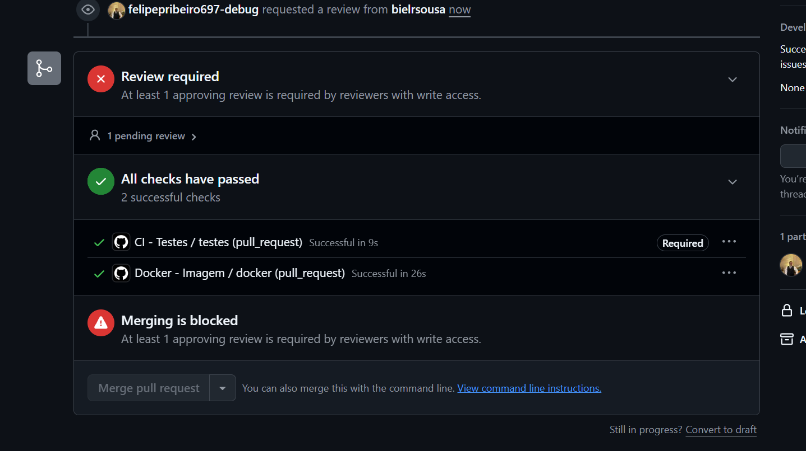
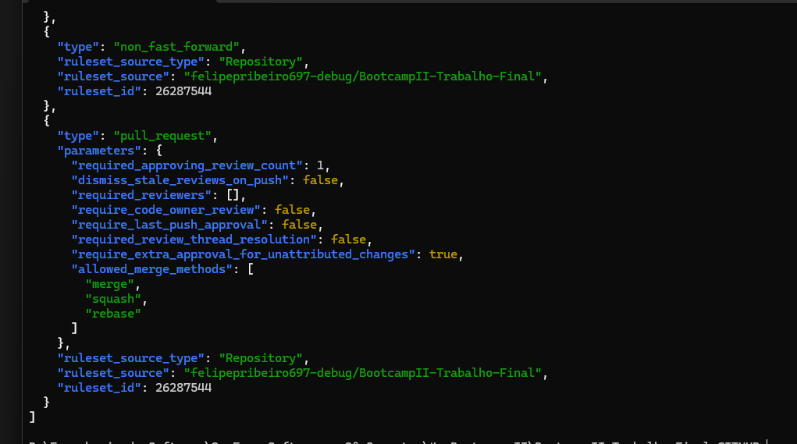
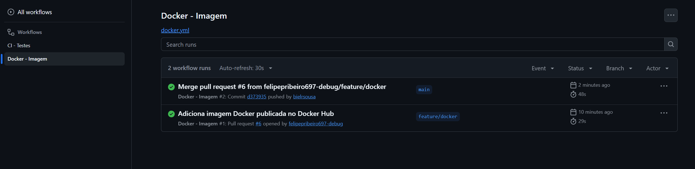
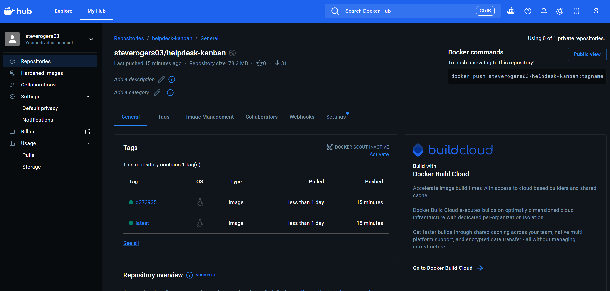
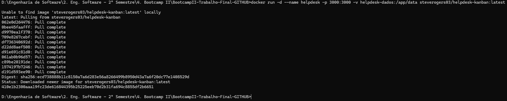

# Helpdesk Kanban — Gerenciador de Tickets de Suporte


Bootcamp II · Etapa 03 · Desafio final em grupo — CEUB

**Repositório:** https://github.com/felipepribeiro697-debug/BootcampII-Trabalho-Final

Sistema estilo **Kanban** para abrir, categorizar e acompanhar chamados técnicos de **hardware e redes**. Cada chamado tem prioridade (com prazo de SLA), técnico responsável e filial de origem. Chamados **críticos** podem virar **issues no GitHub** automaticamente.

---

## 1. Integrantes

| Nome | Matrícula | Usuário GitHub | Funcionalidade (dono) | Principal PR |
|---|---|---|---|---|
| Felipe Domingos Ribeiro Pereira | 22604250 | @felipepribeiro697-debug | Backend e persistência (SQLite), testes + GitHub Actions, Docker | [#1](https://github.com/felipepribeiro697-debug/BootcampII-Trabalho-Final/pull/1) |
| Gabriel Ribeiro de Sousa | 22601424 | @bielrsousa | Integração com APIs externas (ViaCEP e GitHub Issues), frontend Kanban | [#4](https://github.com/felipepribeiro697-debug/BootcampII-Trabalho-Final/pull/4) |

Todo integrante escreve código: o histórico completo das PRs, com autor e revisor de cada uma, está na [seção 5](#5-evidências).

---

## 2. A aplicação

**Funcionalidades**
- Quadro Kanban com 4 colunas: *Aberto → Em andamento → Aguardando peça/terceiro → Resolvido* (arrastar e soltar, ou pelo seletor do card).
- Criar, listar, mover e excluir chamados; filtro por prioridade.
- Prioridades com SLA: crítica 4h · alta 8h · média 24h · baixa 72h. O card mostra as horas restantes ou "SLA estourado".
- Regra de negócio: um chamado só sai de *Aberto* com um técnico responsável atribuído.
- Cadastro de técnicos e de filiais (a filial é cadastrada só com nome + CEP).

**APIs externas consumidas**
| API | Para quê | Precisa de chave? |
|---|---|---|
| [ViaCEP](https://viacep.com.br) | Preenche logradouro, bairro, cidade e UF da filial a partir do CEP | Não |
| [GitHub REST — Issues](https://docs.github.com/rest/issues/issues#create-an-issue) | Chamado com prioridade **crítica** vira issue no repositório configurado | Sim (opcional) — `GITHUB_TOKEN` + `GITHUB_REPO` |

Sem as variáveis do GitHub a aplicação funciona normalmente; só a criação de issues fica desligada (o topo da tela mostra o estado).

**Banco de dados:** SQLite (arquivo `data/helpdesk.db`, via módulo nativo `node:sqlite` — não precisa compilar nada). Tabelas `tickets`, `tecnicos` e `filiais`.

**Stack:** Node.js 22+ · Express · SQLite (módulo nativo `node:sqlite`) · HTML/CSS/JS puro · Jest + Supertest · GitHub Actions · Docker.

```
src/
  server.js            inicia o servidor
  app.js               monta o Express (recebe banco e serviços → testável)
  db.js                schema SQLite + técnicos de exemplo
  regras.js            regras de negócio (funções puras: validação, SLA, CEP)
  asyncHandler.js      encaminha erros das rotas async para o handler de erro
  routes/tickets.js    CRUD de chamados + envio ao GitHub
  routes/cadastros.js  técnicos
  routes/filiais.js    filiais (endereço via ViaCEP) e consulta de CEP
  services/viacep.js   cliente ViaCEP
  services/github.js   cliente GitHub Issues
public/                frontend Kanban (HTML, CSS e JS puro)
tests/                 testes Jest (regras, API, filiais e serviços externos)
.github/workflows/ci.yml       testes a cada PR
.github/workflows/docker.yml   gera, testa e publica a imagem Docker
Dockerfile
```

**Endpoints**
| Método | Rota | Descrição |
|---|---|---|
| GET | `/api/tickets?status=&prioridade=` | lista chamados (com SLA calculado) |
| POST | `/api/tickets` | cria chamado `{titulo, descricao, categoria, prioridade, tecnico_id, filial_id}` |
| PATCH | `/api/tickets/:id` | muda `status`, `tecnico_id` ou `prioridade` |
| DELETE | `/api/tickets/:id` | exclui |
| POST | `/api/tickets/:id/github` | força criação da issue |
| GET/POST/DELETE | `/api/tecnicos` | técnicos |
| GET/POST/DELETE | `/api/filiais` | filiais (`{nome, cep}`) |
| GET | `/api/cep/:cep` | consulta ViaCEP |

---

## 3. Como executar

### Localmente
```bash
npm install
npm start
# abra http://localhost:3000
```

### Com Docker (imagem do Docker Hub)
Imagem pública: https://hub.docker.com/r/steverogers03/helpdesk-kanban

Só precisa do Docker instalado (não precisa de Node nem do código):
```bash
docker run -d --name helpdesk -p 3000:3000 -v helpdesk-dados:/app/data steverogers03/helpdesk-kanban:latest
```
Abra http://localhost:3000. O volume `helpdesk-dados` guarda o banco SQLite, então os chamados continuam lá se o container for recriado.

Com a integração do GitHub ligada (chamado crítico vira issue):
```bash
docker run -d --name helpdesk -p 3000:3000 -v helpdesk-dados:/app/data -e GITHUB_TOKEN=seu_token -e GITHUB_REPO=usuario/repositorio steverogers03/helpdesk-kanban:latest
```

Comandos úteis:
```bash
docker ps                      # STATUS deve mostrar "(healthy)" depois de alguns segundos
docker logs helpdesk           # mostra se a integração com o GitHub está ativa
docker stop helpdesk && docker rm helpdesk
```

### Gerar e publicar a imagem
A imagem é gerada e publicada **automaticamente** pelo workflow [`.github/workflows/docker.yml`](.github/workflows/docker.yml):
- em toda PR, ele gera a imagem e testa o `docker run` (sobe o container e chama `/api/saude`);
- no merge para a `main`, faz o mesmo teste e publica `steverogers03/helpdesk-kanban:latest` (e uma tag com o commit) no Docker Hub.

Para gerar manualmente, numa máquina com Docker:
```bash
docker build -t steverogers03/helpdesk-kanban:latest .
docker login
docker push steverogers03/helpdesk-kanban:latest
```
A imagem usa `node:22-slim`, instala só as dependências de produção, roda com o usuário `node` (não root) e tem *healthcheck* em `/api/saude`.

| Variável | Padrão | Uso |
|---|---|---|
| `PORT` | `3000` | porta HTTP |
| `DB_PATH` | `data/helpdesk.db` (`/app/data/helpdesk.db` no Docker) | arquivo do SQLite |
| `GITHUB_TOKEN` | — | token *fine-grained* com permissão **Issues: Read and write** |
| `GITHUB_REPO` | — | `usuario/repositorio` onde as issues serão abertas |

---

## 4. Testes

```bash
npm test
```
Testes Jest em `tests/` (o total aparece no resumo do `npm test`):
- `regras.test.js` — validação de chamado, CEP, regra de mudança de status, SLA (que congela quando o chamado é resolvido) e montagem da issue.
- `api.test.js` — CRUD de chamados e técnicos pela API com banco em memória, incluindo os casos de erro (técnico inexistente, JSON inválido, regras do Kanban).
- `filiais.test.js` — cadastro de filial pelo CEP e abertura de issue para chamado crítico.
- `servicos.test.js` — clientes do ViaCEP e do GitHub (URL, headers, conversão de campos e erros).

ViaCEP e GitHub são simulados (mocks) em todos os testes, então nenhum depende de internet.

O workflow `.github/workflows/ci.yml` roda os testes em toda PR e todo push para a `main`.

---

## 5. Evidências

### Histórico de Pull Requests (diário de bordo)
Nenhum código entrou direto na `main`: cada funcionalidade nasceu numa branch própria e foi revisada e aprovada pelo outro integrante antes do merge.

| PR | Branch | Autor | Revisor | O que a revisão trouxe |
|---|---|---|---|---|
| [#1](https://github.com/felipepribeiro697-debug/BootcampII-Trabalho-Final/pull/1) | `feature/backend-tickets` | Felipe | Gabriel | Apontou que um erro em rota `async` derrubava o servidor (`tecnico_id` inexistente) e que JSON inválido respondia 500. Corrigido na própria PR com `asyncHandler`, validação de técnico/filial e `err.status`. |
| [#2](https://github.com/felipepribeiro697-debug/BootcampII-Trabalho-Final/pull/2) | `feature/testes-ci` | Felipe | Gabriel | Conferiu que os casos levantados na #1 ganharam testes; sugeriu tirar a contagem fixa de testes do README e atualizar as actions (aviso de Node 20). |
| [#3](https://github.com/felipepribeiro697-debug/BootcampII-Trabalho-Final/pull/3) | `fix/ajustes-revisao` | Felipe | Gabriel | Atendeu aos pontos não bloqueantes da #1 e #2 (regra do técnico no estado final, 409 ao remover técnico ocupado, SLA congelado em `resolvido_em`, actions v6). A revisão notou que a descrição citava 5 testes novos quando eram 4. |
| [#4](https://github.com/felipepribeiro697-debug/BootcampII-Trabalho-Final/pull/4) | `feature/integracao-apis` | Gabriel | Felipe | Revisão com teste do CEP real; sugeriu atualizar a árvore do README e tratar `logradouro` nulo no frontend (atendidos na #5 e #6). |
| [#5](https://github.com/felipepribeiro697-debug/BootcampII-Trabalho-Final/pull/5) | `feature/frontend-kanban` | Gabriel | Felipe | Teste manual do fluxo (filial por CEP, técnico, mudança de coluna, SLA); sugeriu melhorar contraste no tema escuro e acentos nas tags. |
| [#6](https://github.com/felipepribeiro697-debug/BootcampII-Trabalho-Final/pull/6) | `feature/docker` | Felipe | Gabriel | Revisou Dockerfile e workflow; lembrou de confirmar o segredo `DOCKERHUB_TOKEN` e a visibilidade pública da imagem (ambos confirmados). |

### Proteção da main
Ruleset `protege-main` ativo na `main`: **Pull Request obrigatória com 1 aprovação**, **check `testes` obrigatório** (status check), bloqueio de *force push* e de exclusão da branch.

Na PR #6, com os dois checks verdes, o merge seguia bloqueado até a aprovação do revisor; o check de testes aparece marcado como **Required**:



Regras ativas na `main`, consultadas pela API do GitHub (`gh api repos/.../rules/branches/main`):



### PR bloqueada pelo CI
O check `testes` está configurado como obrigatório (selo **Required** no print acima), mas o grupo **não executou** a PR com um teste quebrado de propósito, então não há print do merge bloqueado por teste vermelho.

### GitHub Actions
- `ci.yml` — roda `npm test` em toda PR e push para a `main` (check obrigatório `testes`).
- `docker.yml` — em toda PR gera a imagem e testa o `docker run`; no merge para a `main` publica no Docker Hub.



### Docker Hub
Imagem pública `steverogers03/helpdesk-kanban`, publicada pelo workflow com as tags `latest` e a do commit do merge. O `docker run` do README foi testado baixando a imagem do Docker Hub, inclusive pelo Gabriel em outra máquina.





### Conflito de merge
Não houve conflito de merge. Cada PR foi aberta a partir da `main` atualizada, e na PR #4 as rotas de filiais foram criadas num arquivo próprio (`src/routes/filiais.js`) justamente para não alterar `cadastros.js` e `tickets.js`, que tinham acabado de mudar na PR #3.
